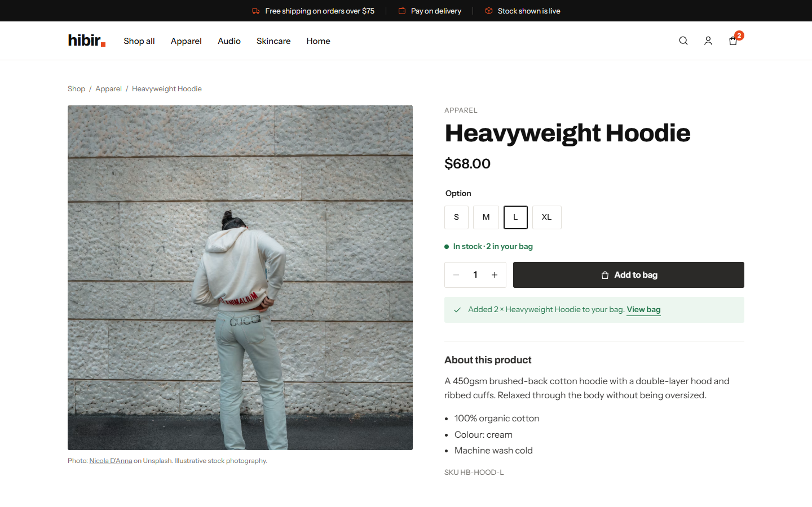
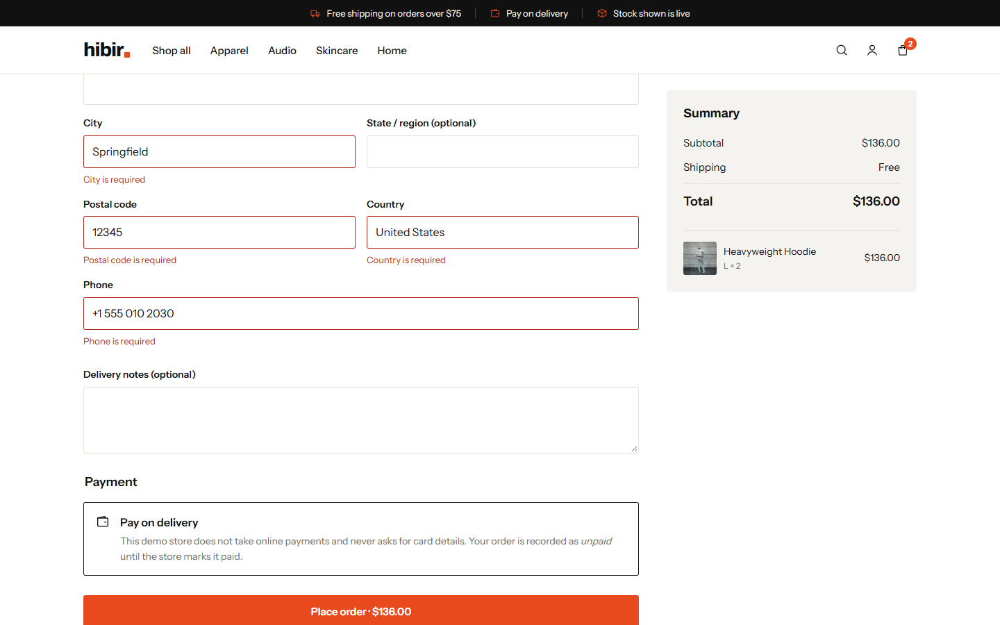
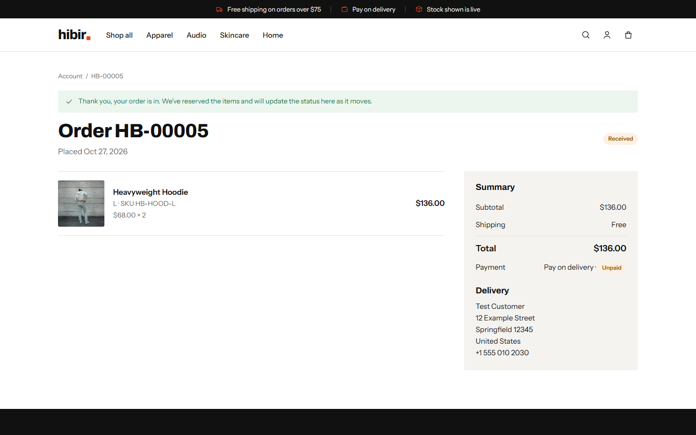
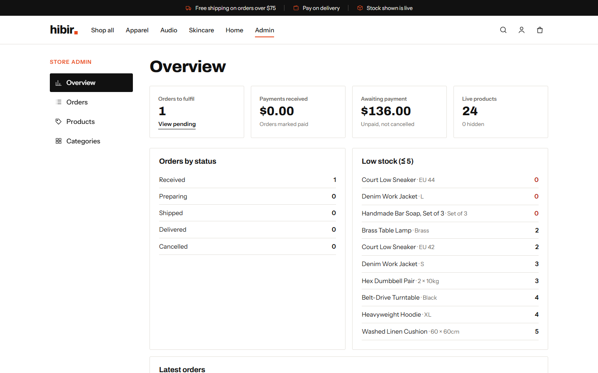
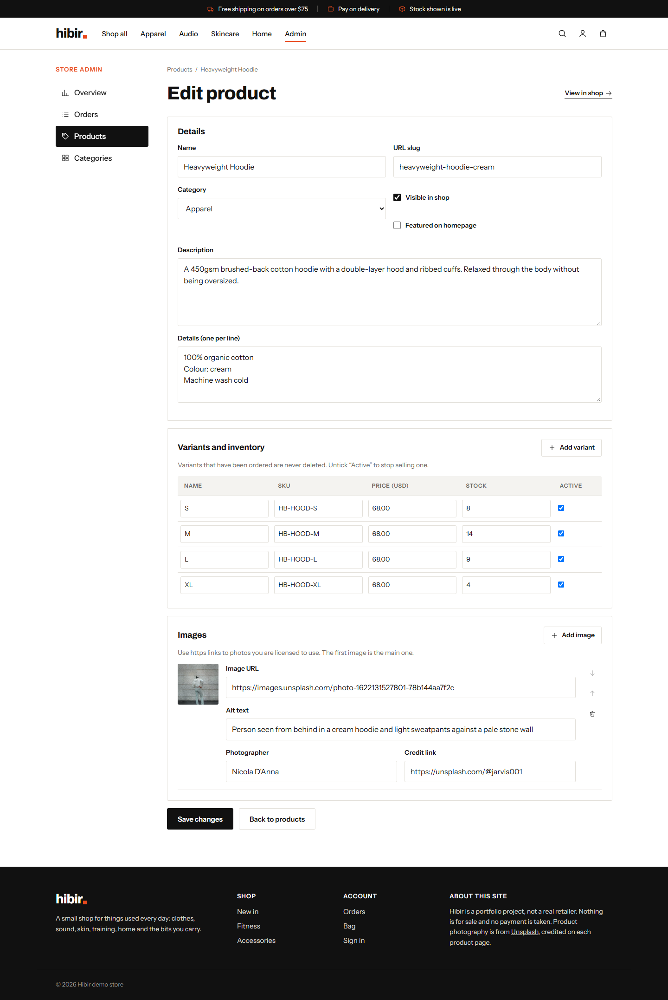
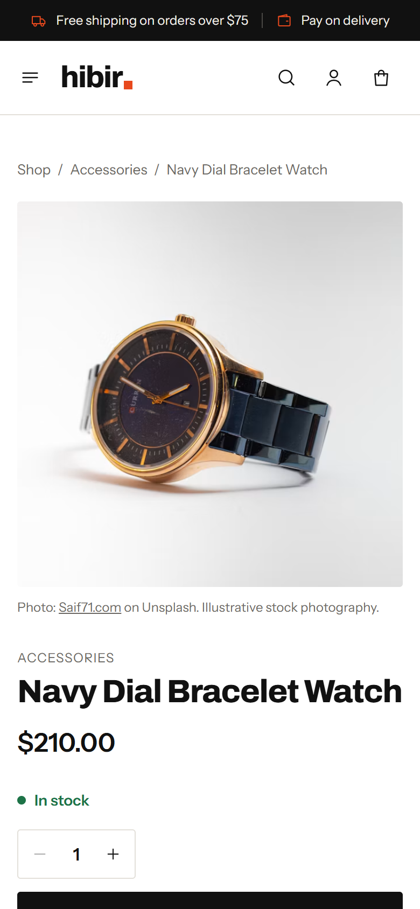

# Hibir

Hibir is a full-stack online store: a React storefront, an Express REST API and a PostgreSQL database. It covers the full path from browsing to an order the shop can fulfil: catalogue search and filters, a bag that persists, accounts, a checkout with server-side pricing and stock reservation, order history, and an admin area for products, inventory, categories and orders.

It is a portfolio project, not a real shop. Nothing is for sale, no payment is taken, and the product photographs are Unsplash stock images used for illustration. They do not show inventory belonging to any real business.


| Product page | Checkout | Order confirmation |
| --- | --- | --- |
|  |  |  |

| Admin overview | Product editor | Mobile |
| --- | --- | --- |
|  |  |  |

## Features

**Storefront**
- Homepage with featured products, categories and the newest arrivals, all loaded from the database.
- Catalogue with text search, category, price-band and in-stock filters, four sort orders and pagination. Filters live in the URL, so results can be shared and bookmarked.
- Product pages with variants (size, capacity, weight), live stock levels, quantity limits and photo credits.
- Bag that persists across sessions. Guests get a server-side bag behind an httpOnly cookie, and it is merged into their account when they sign in or register.
- Registration, sign-in and sign-out. Order history and order detail pages.
- Loading skeletons, empty states, inline validation errors, retryable error states and clear messages when stock changes.
- Responsive from 360px up. Keyboard focus styles, labelled controls, a skip link and reduced-motion support.

**Checkout and inventory**
- The client sends only variant IDs and quantities. Prices, shipping and totals are recalculated on the server from the database. Any price or total sent by the client is ignored.
- Orders are placed in a single transaction. The bag and its variant rows are locked with `SELECT … FOR UPDATE`, stock is checked and decremented, and the bag is emptied. Concurrent buyers cannot oversell the last units.
- Each checkout attempt carries an idempotency key, enforced by a unique constraint, so double clicks and retries return the original order instead of creating a second one.
- Inactive products, out-of-stock variants and quantities above stock are rejected when adding to the bag, and checked again at checkout.
- Order lines store a snapshot of the name, SKU and price, so later catalogue edits do not change past orders.

**Administration** (role checked on the server for every `/api/admin` request)
- Overview built from live data: orders by status, payments marked as received, unpaid totals, low-stock variants and the latest orders.
- Create and edit products, including variants, prices, stock, images (https URLs with alt text and photo credit) and descriptions. Products can be shown, hidden or featured.
- Variants that appear in past orders are never deleted. Removing one from a product deactivates it instead.
- Create, edit and hide categories.
- Order list with a status filter. Orders move through `pending → processing → shipped → delivered`, and pending or processing orders can be cancelled. Cancelling returns stock to inventory, and invalid transitions are refused. Payment status can be set to unpaid, paid or refunded.

### Payments

No payment provider is integrated. Checkout uses **pay on delivery**: the order is stored with `payment_status = 'unpaid'`, and the payment status changes only when an administrator sets it. The app never asks for or stores card details, and it never shows a payment as successful. Adding Stripe Checkout in test mode would mean creating a session from the server-side order total and marking the order paid from a verified webhook. It was not added because no test credentials were available.

## Stack and architecture

| Layer | Choice |
| --- | --- |
| Frontend | React 19, TypeScript, Vite, React Router |
| Backend | Node.js 24, Express 5, TypeScript |
| Database | PostgreSQL 17 through `pg`, with plain SQL migrations |
| Validation | Zod, on every request body and query string |
| Security | helmet (CSP and related headers), CORS allow-list, express-rate-limit, scrypt password hashing |
| Tests | Vitest and Supertest (API, against a real PostgreSQL database), Testing Library (components), playwright-core with local Chrome (browser walkthrough) |

```
client/                 React SPA (Vite)
  src/pages/            storefront, account and admin screens
  src/context/          auth and bag state
  src/components/       layout, product card, form fields, state views, icons
server/
  migrations/           numbered SQL migrations
  src/routes/           auth, catalog, cart, orders, admin
  src/services/         cart resolution and merging, checkout transaction
  src/middleware/       sessions and roles, origin guard, error handling
  src/seed/             demo catalogue and first admin
  test/                 unit and API integration tests
scripts/                local PostgreSQL setup, browser walkthrough
```

In development, Vite serves the client on port 5173 and proxies `/api` to Express on port 4000. In production, Express serves the built client and the API from the same origin.

Sessions are random 256-bit tokens stored as SHA-256 hashes in the `sessions` table and sent as an httpOnly, `SameSite=Lax` cookie. There are no JWTs and nothing sensitive is kept in `localStorage`.

## Running on Windows

Requirements: Node.js 20.12 or newer (developed on 24) and PostgreSQL 15 or newer.

```powershell
git clone <your-repo-url> hibir
cd hibir
npm install
```

### 1. Database

**Option A: an existing PostgreSQL server.** Create two databases, `hibir` and `hibir_test`, then copy the example environment file and fill in the connection strings:

```powershell
Copy-Item server\.env.example server\.env
notepad server\.env
```

**Option B: a local cluster created by the setup script** (no admin rights or Windows service needed). Point it at a PostgreSQL `bin` folder that contains `initdb.exe` and `pg_ctl.exe`; `psql` is not required:

```powershell
npm run db:setup -- -PgBin "C:\Program Files\PostgreSQL\17\bin"
```

The script initialises `%USERPROFILE%\pgdata-hibir` only if it is empty, and reuses a server that is already running on the port. It creates both databases and writes `server\.env` with generated passwords. It never deletes data. If a cluster exists but its password has been lost, add `-ResetPassword`: this enables password-free login from 127.0.0.1 for a moment, sets a new password, and restores `pg_hba.conf`. After a reboot, start the server with:

```powershell
& "<PgBin>\pg_ctl.exe" -D "$env:USERPROFILE\pgdata-hibir" -l "$env:USERPROFILE\pgdata-hibir\server.log" start
```

### 2. Migrate and seed

```powershell
npm run db:migrate   # applies server/migrations/*.sql in order, tracked in schema_migrations
npm run db:seed      # migrates, then loads 6 categories and 24 products, and creates the admin from ADMIN_EMAIL / ADMIN_PASSWORD
```

The seed command loads the catalogue only into an empty database and leaves an existing admin account unchanged.

### 3. Run

```powershell
npm run dev          # API on http://localhost:4000, storefront on http://localhost:5173
```

To run a production build locally:

```powershell
npm run build
$env:NODE_ENV="production"; $env:CLIENT_ORIGIN="http://localhost:4000"; npm start   # http://localhost:4000
```

### Environment variables (`server/.env`)

| Variable | Purpose |
| --- | --- |
| `DATABASE_URL` | Main database connection string |
| `TEST_DATABASE_URL` | Separate database for the API tests. It is truncated on every run, and the tests refuse to start if it equals `DATABASE_URL` |
| `PORT` | API port (default 4000) |
| `CLIENT_ORIGIN` | Comma-separated origins allowed by CORS and the origin guard |
| `COOKIE_SECURE` | `true` when served over HTTPS |
| `SESSION_TTL_DAYS` | Session lifetime (default 14) |
| `ADMIN_EMAIL`, `ADMIN_PASSWORD` | Used only by `db:seed` to create the first administrator. The password must be at least 12 characters |

## Tests and checks

```powershell
npm run typecheck    # tsc for server and client
npm test             # server unit + API integration tests, then client component tests
npm run build        # production builds
npm run e2e          # browser walkthrough; needs `npm run dev` running and Google Chrome installed
```

The API tests run against `TEST_DATABASE_URL`. They cover:
- registration, login, logout, duplicate emails and identical error responses for unknown versus wrong-password accounts;
- catalogue filtering, sorting and escaping of LIKE wildcards;
- guest bag merging into the account;
- stock and quantity limits;
- checkout totals, free-shipping threshold, ignored client prices, price changes after adding to the bag, deactivated items;
- duplicate submissions with the same key, two customers racing for the last units, and order privacy between customers;
- admin role enforcement, product editing that preserves ordered variants, order status transitions with restocking;
- origin and content-type guards, and malformed JSON.

`scripts/e2e.mjs` drives Chrome through the main journeys and saves the screenshots in `docs/screenshots`. At 1440px wide it goes from browsing through a guest bag, registration, checkout with a double-clicked submit, and order history, then checks that customers are blocked from admin and that an admin can update an order. At 390px it checks layout, the filters panel and the menu.

Results on 2026-10-27 (Windows 11, Node 24.15, PostgreSQL 17.11):
- Type checks pass for server and client.
- Server tests: 30 passed. Client tests: 7 passed.
- Production builds succeed.
- Browser walkthrough: 21 of 21 checks passed, with no console errors and no 5xx responses. It passed against both the dev server and the production build.
- `npm audit --omit=dev`: 0 vulnerabilities.

The browser walkthrough places a real order in the development database with a throwaway `e2e-…@example.test` account. When it finishes, it deletes that account and its order, returns the reserved stock, and ends the admin session it opened. This also happens if a check fails. Run `npm run e2e -- --keep` to leave the data in place for debugging.

## Security notes

- Passwords are hashed with scrypt (N=2¹⁵, r=8, p=1) and a per-user salt, and compared in constant time. Unknown emails still go through a hash comparison, so response time does not reveal which accounts exist.
- Authorisation is enforced by the server on every request. The admin UI guard is only a convenience. Customers can read only their own orders: other customers' orders return 404.
- Every input is validated with Zod: length limits, https-only image URLs, SKU, slug, phone and postal code formats. All SQL is parameterised.
- Protection against cross-site requests: `SameSite=Lax` cookies, a CORS allow-list, an origin check on state-changing requests, and a requirement that request bodies are JSON.
- Rate limits apply to the sign-in, registration and checkout endpoints. JSON bodies are capped at 100 kB.
- Internal errors are logged on the server and returned to the client as a generic message. Database constraint violations become 409 responses.
- `.env` files, `node_modules`, build output and local database folders are ignored by git. `server/.env.example` contains only placeholders.

## Limitations

- **Payments:** no payment provider is integrated (see [Payments](#payments)).
- **Accounts:** there is no email delivery, so no email verification or password reset.
- **Images:** images are referenced by URL. The admin cannot upload files.
- **Rate limits:** rate limits are kept in memory, so they reset on restart and are not shared between server instances.
- **Hosting:** Express assumes it sits behind a TLS-terminating proxy in production. Set `COOKIE_SECURE=true` there.
- **Icons:** the line icons were drawn for this project. Iconly icons can replace them (see `client/src/icons/README.md`). They are not bundled because Iconly's licence restricts redistributing its files.
- **Not production-ready:** passing builds and tests here do not make it so. Before taking real orders it would still need a hosting setup, monitoring, backups, real payments and a privacy review.

## Image credits

All photographs are from [Unsplash](https://unsplash.com) and used under the [Unsplash License](https://unsplash.com/license). Each product's photographer is credited on its product page and in `server/src/seed/catalog.ts`. Homepage images:
- [Ilona Panych](https://unsplash.com/@we_are_details) (hero)
- [Tim Chow](https://unsplash.com/@rkdamedia) (training banner)
- [Debby Hudson](https://unsplash.com/@hudsoncrafted) (home banner)

## Skills demonstrated

- Relational schema design with constraints, indexes and versioned SQL migrations.
- Transactional consistency: row locking, idempotent writes, stock reservation and restocking.
- Secure session-based authentication and server-enforced role-based access control.
- A REST API with schema validation, consistent error responses and defensive middleware.
- A typed React SPA with context state, URL-driven filters and complete loading, empty and error states.
- Responsive, accessible CSS without a UI framework.
- Automated tests at three levels (unit, API integration against PostgreSQL, real-browser walkthrough).
- Windows-specific tooling: a non-destructive PowerShell script to provision PostgreSQL.
